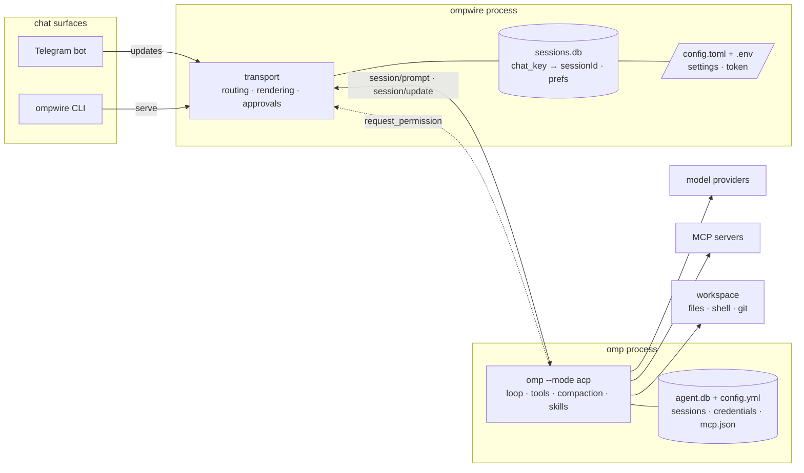

# ompwire

Drive an [OMP](https://omp.sh) agent from any chat surface over the **Agent Client Protocol**.

`ompwire` is a transport. It moves messages between a chat interface and an OMP agent, renders what the agent streams back, answers its permission prompts, and remembers which ACP session belongs to which conversation. Everything else (agent loop, tools, MCP servers, context compaction, skills, memory, system prompt) stays inside the agent where it belongs.

> Status: early but usable. The CLI and the Telegram transport both drive the same agent path; the Telegram side covers sessions, model/mode/thinking switching, approvals, queueing and cost reporting.

## Why

Most chat frontends for coding agents reimplement the agent: their own loop, their own tool registry, their own compaction, their own prompt. That duplication is where they rot.

OMP already ships that machinery and speaks ACP over stdio. So a frontend only needs the parts a chat client actually owns: transport, streaming, approvals, session routing. That is what this repo is, and it is deliberately small enough to read in one sitting.

## How it works

A chat surface, one transport process, one agent process. Nothing between them but
the Agent Client Protocol over stdio.



Interactive version of the same picture, with the failure modes drawn in:
[`docs/ompwire-architecture.html`](docs/ompwire-architecture.html) (open in a browser;
generated with [archify](https://github.com/tt-a1i/archify)).

### Components and what each one owns

| Component | Owns | Fails how | Fallback |
|---|---|---|---|
| Transport | routing, streaming, approvals, rendering, per-chat prefs | a Telegram edit fails, markup is rejected | resend as plain text instead of losing the message |
| `sessions.db` | `chat_key → sessionId`, prefs, approval override | unreadable | a new agent session; the chat key is kept |
| ACP client | stdio framing, request ids, timeouts | the subprocess dies mid-turn | respawn, then `session/load` on the same session id |
| Agent (omp) | loop, tools, MCP, compaction, skills, memory | provider or tool error | reported to the chat as the agent's own error text |
| Catalogs | model/mode/thinking lists, providers, skills | the agent will not answer a probe | empty list, and the command says so instead of inventing options |

### A turn, end to end

1. Telegram delivers an update; the transport drops it unless the sender is in `allowed_users`.
2. The chat key is resolved to a session id (`sessions.db`), or a new ACP session is created.
3. Stored prefs (model, mode, thinking, yolo) are replayed onto the fresh session via `session/set_config_option`, and the reply refreshes the cached option lists.
4. The message becomes a `session/prompt`; images are attached as `image` content blocks.
5. `session/update` chunks stream back: prose is batched into edits, tool calls into a separate `🔧` message so the answer is never clobbered.
6. `session/request_permission` becomes a picker; the answer is `allow`/`deny` plus a persisted override, so the same tool is not asked twice.
7. Every action lands in a rotating log with the token redacted before it reaches a handler.
8. If the agent proposes concrete options (`<<options: a | b>>`), they arrive as buttons; the answer is sent back as a normal message.

### Requirements this design is sized by

| Requirement | Target | How it is met |
|---|---|---|
| Resume after restart | one call, not a transcript replay | session id in sqlite, `session/load` on startup |
| First token on screen | under a second after the agent starts answering | chunk batching on an interval, not per token |
| Approval visibility | never silent | every permission request becomes a message that stays until answered |
| Secret exposure | zero tokens in logs | redaction filter on every handler, `ompwire scrub-logs` for old files |
| Agent reachability | fail loudly | `serve` checks the agent, the platform and the token before polling |

### Decision record

| Decision | Alternatives rejected | Why | What it costs |
|---|---|---|---|
| Transport only | a full chat client with its own loop | OMP already owns the loop, tools and compaction; a second copy is where frontends rot | features that need agent state must go upstream |
| ACP over stdio | provider HTTP APIs called directly | the agent authenticates itself, so no keys live here | ACP shape becomes a contract to follow |
| One subprocess per conversation | one shared agent with multiplexed sessions | a stuck turn cannot block other chats, and `cwd` is per chat | process memory per active chat |
| HTML `parse_mode` | MarkdownV2 | MarkdownV2 needs 18 characters escaped; HTML needs 3, and `<pre>` content is never parsed | markup must be built, not pasted |
| Catalogs read from the agent | a hard-coded provider/model list | lists drift the day the agent ships a new provider | a probe costs one extra subprocess call |
| Formatting via `--append-system-prompt` | post-processing the model's markdown | fences, short paragraphs and the options marker are cheaper to ask for than to repair | a prompt hint that must stay short |
| Git tags + `uv tool`, not PyPI | publishing to PyPI | the transport depends on a specific agent surface, so edge installs matter | needs git credentials on the installing machine |

## Use cases

The same transport, four shapes of work. Each one is a different answer to "where is
the agent running, and who is watching it".

**1. Unblock a long task from a phone.** A refactor runs on the workstation, pauses on
a permission request, and the request lands in Telegram with the command and its
arguments. Approving from the phone continues the same turn; nothing is re-run.

**2. Review queue on a second device.** `/review` style work: the agent reads a diff,
streams findings into the chat, and the buttons carry the follow-up decision. The
session id survives a laptop restart, so the queue is not rebuilt.

**3. Multiple worktrees, one inbox.** Each chat maps to its own working directory, so a
backend repo and a mobile app repo can sit in different chats with different models and
different approval posture, without a multiplexer in between.

**4. A transport you can audit.** Every action is in the log, every message is a
rendered card, and the whole surface is one file — small enough to read before pointing
it at a machine that has credentials on it.

The counter-case matters too: if the work needs a browser, a full TUI, or multi-agent
orchestration, drive the agent directly. This is a chat transport, not a replacement for
the terminal.

## What it does

- spawns and supervises one `omp --mode acp` subprocess per conversation
- streams `agent_message_chunk` to the user as it arrives
- turns `session/request_permission` into an answer (`allow`, `deny`, or an interactive prompt)
- maps `chat_key → sessionId` in sqlite, and resumes with `session/load`
- switches model and mode through the agent's own `configOptions`
- passes through any MCP servers you list in config, per session

## What it deliberately does not do

- no memory layer (OMP owns `memory.backend`)
- no tool registry, no skills loader, no system prompt, no compaction
- no second agent loop competing with the one inside OMP
- no model provider keys: the agent authenticates itself

If a feature needs agent state, it belongs upstream in OMP, not here.

## Requirements

- `omp` on `PATH` (tested against 18.12.6; `--mode acp` is undocumented, see [Compatibility](#compatibility))
- Python 3.11 or newer
- No Python dependencies for the CLI

## Install

One script, `install.sh`, at the repo root. On a machine that may not have anything yet:

```bash
# while the repo is private, go through your own gh auth
gh api repos/pandudpn/ompwire/contents/install.sh \
   -H "Accept: application/vnd.github.raw" | bash

# once the repo is public this is enough
curl -fsSL https://raw.githubusercontent.com/pandudpn/ompwire/main/install.sh | bash
```

Flags: `--ref vX.Y.Z` (default: newest release), `--no-setup`, `--no-omp`, `--no-path`,
`--help`. The same values work as `OMPWIRE_*` environment variables, which matters when
the script arrives on stdin: `curl … | bash -s -- --ref v0.7.0`.

It installs `omp` if it is missing (official installer, after asking), installs ompwire
from the newest release tag, **puts `~/.local/bin` on `PATH` for your shell** (zsh, bash,
fish or plain sh — one guarded line, written once), and hands over to `ompwire setup`. So
`ompwire` works in the next shell without a manual `export`. Set `OMPWIRE_NO_PATH_EDIT=1`
to leave your shell config alone.

The repo is private, so the entry point goes through your own `gh` auth instead of an
anonymous `curl`.

From a clone, the same script runs directly:

```bash
git clone https://github.com/pandudpn/ompwire.git
cd ompwire && uv venv && uv pip install -e '.[dev]'
./install.sh                  # or skip it and use .venv/bin/ompwire
```

Manual install, when you would rather see each step:

```bash
# one-off, no install
uvx --from git+https://github.com/pandudpn/ompwire.git@v0.6.0 ompwire doctor

# install the newest release
uv tool install --from git+https://github.com/pandudpn/ompwire.git@v0.6.0 ompwire

# follow main instead
uv tool install --from git+https://github.com/pandudpn/ompwire.git@main ompwire
```

`pipx install git+https://github.com/pandudpn/ompwire.git@v0.6.0` is supported by the
same code path, though only `uv` is verified on this machine.

### Working from a checkout

`uv tool install` puts `ompwire` in `~/.local/bin`. A checkout does not, so one symlink
makes the command available everywhere without a second copy to keep in sync:

```bash
ln -sfn "$PWD/.venv/bin/ompwire" ~/.local/bin/ompwire
```

If a shell still says `command not found`, it started before the symlink existed:
`hash -r` (or a new shell) fixes the lookup.

## The CLI

```bash
ompwire                  # help, with the flows people actually run
ompwire help setup       # per-command help and examples
ompwire --version        # or -V
```

| Command | What it is for |
|---|---|
| `ompwire setup` | first machine: agent, provider and model, thinking, mode, yolo, cwd, MCP, gateway |
| `ompwire doctor` | verify agent, session store and bot token, one line per check |
| `ompwire serve` | run the Telegram transport |
| `ompwire chat` | talk to the agent from this terminal (`-q` for one-shot) |
| `ompwire sessions` | the `chat_key → sessionId` map |
| `ompwire config` | merged config with secrets masked |
| `ompwire update [--edge] [--check]` | newest release, or the tip of main |
| `ompwire uninstall [--dry-run]` | remove ompwire, never `~/.omp` |
| `ompwire scrub-logs` | clean bot tokens out of a log file written before redaction existed |

Working from a checkout, one symlink makes the command available everywhere without a
second copy to keep in sync:

```bash
ln -sfn "$PWD/.venv/bin/ompwire" ~/.local/bin/ompwire
```

An installed copy (`uv tool install …`) already puts `ompwire` on `PATH`.

## Setup

```bash
ompwire setup
```

Setup does three things in this order, because the transport is useless without the
first:

1. **Checks for `omp`.** If the agent is missing it prints the official installer
   (`curl -fsSL https://omp.sh/install | sh`) and offers to run it. Nothing else is
   written until an agent is on disk — `ompwire serve` refuses to start otherwise.
2. **Writes `~/.config/ompwire/config.toml`** with the working directory, approval
   policy, MCP source and allowed Telegram user ids. An existing config is kept;
   `--force` moves it to `config.toml.bak` first.
3. **Writes `~/.config/ompwire/.env` (0600)** with the bot token, asked for with
   hidden input, then verified with `getMe` and reported as `token valid: @name`.
   The token is never echoed back and never lands in `config.toml`.

Re-running `ompwire setup` edits the config instead of replacing it: every prompt is
pre-filled with the value currently on disk, so pressing enter keeps it and typing
changes one thing. The token is reused without asking while `getMe` still accepts it, and
`--force` starts over from the agent's defaults when you want a clean rewrite.

`ompwire setup --yes` takes every default without prompting, which is what a
provisioning script wants. Afterwards: `ompwire doctor`, then `ompwire serve`.

Working on ompwire itself: clone it, `uv venv && uv pip install -e '.[dev]'`, and
run `.venv/bin/ompwire serve` — the checkout keeps its own session store.

## Update

```bash
ompwire update            # newest release tag
ompwire update --edge     # tip of main, for testing what is not released yet
ompwire update --check    # report the target, change nothing
ompwire version           # installed version, commit, and which installer owns it
```

`update` inspects how ompwire was installed (uv tool, pipx, or a git checkout) and
runs the matching command, so the same verb works everywhere. On a checkout it
prints the `git fetch --tags && git checkout <ref>` line instead of guessing.

A successful update **restarts the gateway**, because a running transport keeps the old
code in memory and an update that is not picked up is an update that did not happen:

- an active systemd user unit (`ompwire`) is restarted with `systemctl --user restart`;
- otherwise the transport process is stopped and respawned with the same interpreter
  line, output going to the configured log file. A shell wrapper (`zsh -lic … | tee`) is
  not respawned, since that would stack a second `tee`.

`--no-restart` leaves it running. `ompwire restart` does the same thing without updating.


```bash
git clone https://github.com/pandudpn/ompwire
cd ompwire
uv venv && source .venv/bin/activate
uv pip install -e .
cp config.toml.example ~/.config/ompwire/config.toml
```

Verify the wire before using it:

```bash
$ ompwire doctor
ok   agent command: /home/pandu/.local/bin/omp
ok   session store writable: /home/pandu/.local/state/ompwire/sessions.db
ok   ACP handshake: omp 18.12.6 (protocol 1)
     capabilities: loadSession=True sessions=['close', 'fork', 'list', 'resume']
ok   session/new: 01a16c3e · config options ['mode', 'model', 'thinking']
     model now: omniroute/chat (174 available)
--   telegram token missing
ready · ompwire 0.1.0
```

## Uninstall

```bash
ompwire uninstall --dry-run     # list what would go, remove nothing
ompwire uninstall               # ask, then remove
ompwire uninstall --yes         # no prompt
ompwire uninstall --keep-config # keep config.toml and .env (the bot token)
ompwire uninstall --force       # stop a running `ompwire serve` first
```

It removes exactly what ompwire created and nothing else:

| Path | Holds |
|---|---|
| `~/.config/ompwire/` | `config.toml`, `.env` with the bot token (skipped by `--keep-config`) |
| `~/.local/state/ompwire/` | `sessions.db`, per-chat prefs, approval override, logs |
| `~/.local/share/ompwire/` | MCP server installs ompwire set up |
| the installed package | `uv tool uninstall` or `pipx uninstall`, whichever owns it |

`~/.omp` is never touched — agent sessions, credentials and MCP config survive, so
reinstalling ompwire picks the conversation history back up. A live `ompwire serve` is
refused by default because it rewrites its state on exit; `--force` stops it first.
Removing the bot from Telegram itself is done in @BotFather, not here.

## Use

```bash
ompwire chat                        # interactive; resumes this cwd's session
ompwire chat -q "explain this repo" # one-shot
ompwire sessions                    # recorded chat_key → sessionId
ompwire config                      # resolved config, secrets redacted
```

In session: `/new`, `/model <id>`, `/mode <default|plan>`, `/help`, `/exit`.

A resumed turn looks like this. The process is new, the conversation is not:

```
$ ompwire chat -q "what did I ask you to remember?"
ompwire · omp 18.12.6 · session resumed 01a16c3e · cwd /home/pandu
OMPWIRE-OK
  [turn] end_turn · in 114 out 7 cached 45952
```

## Configuration

TOML at `~/.config/ompwire/config.toml` (fallback `~/.ompwire/config.toml`). Secrets live in `.env`, not in the config, so the file is safe to commit as `config.toml.example`.

| Section | Keys |
|---|---|
| `[acp]` | `command`, `args`, `startup_timeout`, `turn_timeout` |
| `[agent]` | `cwd`, `model`, `mode`, `approval_mode`, `permission_policy` |
| `[session]` | `store`, `idle_timeout` |
| `[stream]` | `enabled`, `edit_interval`, `show_tool_calls`, `show_usage` |
| `[mcp]` | `source` (`none`/`inline`/`mcp-hub`), `hub_path`, `include`, `exclude`, `overrides` |
| `[[mcp.servers]]` | `name`, `command`, `args`, forwarded to `session/new` |
| `[telegram]` | `bot_token` (env), `allowed_users`, `home_channel` |

Every key can be set through an `OMPWIRE_*` environment variable; `ompwire config` prints the merged result with secrets masked.

TOML rather than YAML: Python 3.11+ parses it with stdlib `tomllib` (no PyYAML), and it has no indentation traps.

## The ACP contract

What ompwire relies on, verified against the live binary:

| Method | Direction | Used for |
|---|---|---|
| `initialize` | → | handshake; assert agent name, `loadSession`, capabilities |
| `session/new` | → | open a conversation; read `configOptions` |
| `session/load` | → | resume after a restart (agent replays the transcript, see below) |
| `session/prompt` | → | one turn; returns `stopReason` and `usage` |
| `session/update` | ← | `agent_message_chunk`, `tool_call`, `usage_update`, `available_commands_update` |
| `session/request_permission` | ← | approval request; answered with an `optionId` |
| `session/set_config_option` | → | switch model, mode, thinking; returns the full `configOptions` set |
| `session/fork` | → | branch a conversation; new `sessionId` inherits the context |
| `session/list` | → | history: `{sessionId, cwd, updatedAt, _meta{messageCount,size}}` |
| `session/cancel` | → | stop a running turn |
| `session/close` | → | release the session |
| `_session/steering` | → | steer a running turn (extension, see Queue vs steer) |

## Design notes

These are the sharp edges found while building it. They are the reason `tests/` runs against the real binary rather than a mock.

- **`session/load` replays the transcript.** A resumed session re-emits prior assistant messages as `session/update` frames. A frontend that keeps its update handler attached dumps every old answer into the chat. `ChatSession.open` mutes updates while loading.
- **Permissions are option ids, not booleans.** `session/request_permission` returns options with `kind` (`allow_once`, `reject_once`, ...); the reply is `{outcome: {outcome: "selected", optionId}}`. Always pick from what the agent offered.
- **Model selection is a config option.** There is no ACP-level model field; it is `configOptions` entry `id = "model"`, set through `session/set_config_option`.
- **Keep the process warm.** A turn costs a large baseline of input tokens (OMP's own prompt), most of it cache-served on later turns. Spawning per message throws that away.
- **One subprocess per conversation** is the whole concurrency model. That is enough for a personal assistant and not enough for a public bot.
- **mcp-hub is supported directly.** `[mcp] source = "mcp-hub"` reads `~/mcp-hub/servers.yaml` and converts each entry: stdio argv is split, env/headers mappings become arrays, remote transports become `type = "http"`. Per-server `[mcp.overrides.<name>]` patches one entry without editing the shared hub file.
- **`mcpServers` needs `env` as a list.** `session/new` with an entry whose `env` is an object, or missing, fails with `Internal error / undefined is not an object`. `{"name": "x", "type": "stdio", "command": "npx", "args": [...], "env": []}` is the shape omp 18.12.6 accepts; dict-shaped env config is converted automatically, and a failure falls back to a session without MCP servers instead of blocking the chat.

## Development

```bash
make install   # venv + editable install + telegram extra
make test      # contract tests against the real agent
make doctor
```

Tests skip cleanly when `omp` is absent from `PATH`. They never mock the wire: their job is to fail when the agent changes shape.

## Commands (Telegram transport)

The transport owns session routing, approvals, streaming and cost reporting. Anything else is forwarded to the agent as a prompt: OMP already advertises 1153 commands over `available_commands_update`, including every `/skill:<name>` in your skills directories, so re-implementing them here would only create drift.

| Command | Backed by |
|---|---|
| `/new` | `session/new` |
| `/sessions` | `session/list` (`updatedAt`, `cwd`, `size`; no titles) |
| `/resume <id>`, `/continue` | `session/load` |
| `/fork` | `session/fork`, inherits context under a new id |
| `/model <id>`, `/mode <default\|plan>`, `/thinking <level>` | `session/set_config_option` |
| `/skills [query]` | filter of the agent's advertised command list |
| `/stop` | `session/cancel` |
| `/status` | transport state: session id, cwd, model/mode/thinking, process age |
| `/usage` | accumulated `usage_update` frames per session |
| `/context` | forwarded to the agent, which owns the context accounting |
| `/skills` | browse every loadable skill, tap one to read its `SKILL.md` |
| `/login` | sign in to a model provider, with current status per provider |
| `/approve` | show or set the approval policy (`ask` / `allow` / `deny`), persisted to `overrides.json` |
| `/verbose` | toggle the tool-call trace |
| `/queue <text>` | harness FIFO, dispatched after the running turn ends |
| `/steer <text>` | `_session/steering` extension, experimental (see below) |
| `/cwd <path>` | new session in that directory, old id kept |
| `/yolo` | respawns the agent with `--approval-mode=yolo` |
| `/kill` | terminates the agent subprocess for this chat |
| `/help`, `/whoami` | transport metadata |

`/model`, `/mode` and `/thinking` open inline keyboards rather than printing a list: for the model you pick a provider first (grouped from the `provider/model` id), then page through that provider's models; the current value is marked with a dot. Turns show Telegram's native typing indicator, so no "working…" placeholder is posted into the chat.

### Chat rendering

Agent prose and tool activity are kept apart, because they are different things.

- Answers render as markdown: headings, bold, italic, links, bullets and fenced code blocks become Telegram HTML (`mdrender.py`), and bar-chart lines (as printed by the agent's own `/context`) are kept in a monospace block so the bars stay aligned. A half-streamed message still produces valid HTML, and a rejected parse falls back to plain text instead of dropping the reply.
- Tool calls stream into a separate trace message, shell-styled: the command in `<code>`, its output in a `<pre>` block, status while it runs. `/verbose` toggles it.
- Approval prompts name the tool, show the exact command in a monospace block, and offer labelled buttons (allow once / always / deny). The prompt is then rewritten in place with the decision, so no stale keyboard is left behind. Photos sent to the chat are forwarded to the agent as ACP image blocks.
- Session changes (`/new`, `/fork`, `/resume`, `/cwd`) answer with a card showing session id, model, mode, thinking level, approval policy, yolo state and cwd.
- Token usage is not posted per turn (`stream.show_usage = false`); `/usage` reports the session totals.

### Catalogs

Two lists come straight from omp, so they cannot drift from it:

- **`/login`** reads omp's own login menu and marks the entries that already hold credentials (`omp auth export`, provider names only, never the secrets). Ten per page, two columns, like the model picker. Tapping a provider starts `omp login` on a pty; when the OAuth URL appears it is posted with a button, and once omp asks for the authorization code the next message typed into the chat is forwarded to it. Providers without a known CLI id are selected through omp's numbered menu instead.
- **`/skills`** lists every `SKILL.md` omp can load, ten per page. Tapping one sends its body rendered as markdown, clipped with a pointer to the file when it is long.

### Answers as buttons

omp's `ask` tool is interactive-mode only, so an ACP session cannot pop up a
picker. The transport asks the model to end a question with

```
<<options: postgres | mysql | sqlite>>
```

The marker is stripped from the message and turned into one button per option
plus **Other answer**, which simply invites free text; the chosen text is sent as
the next prompt. Without the marker everything behaves as before, so a forgotten
marker costs nothing.

### Formatting comes from the prompt, not from luck

omp does not know it is writing into a chat window, and left alone it emits commands inline. ompwire appends a short system prompt (`agent.append_system_prompt`) telling it to use fenced code blocks with language tags, short paragraphs and bullets. Set it to `""` to send omp's prompt untouched. Verified on a live turn: without the hint the reply had no fence, with it the reply came back as a `bash` block.

### Lifecycle

Startup posts what actually came up: ompwire version, agent version, session id, model/mode/thinking, cwd, approval policy, MCP servers, allowed users and the session store path. Shutdown posts uptime and how many agent processes were closed. Every config change is announced with the old and new value, and persisted so a restart keeps it.

## Queue vs steer

These are not the same thing, and the wire decides which one is safe.

Measured against omp 18.12.6:

| Action while a turn is running | Result |
|---|---|
| second `session/prompt` | running turn ends with `stopReason: "cancelled"` (reproduced 3x) |
| `session/prompt` with `_meta.steering.queue: "followUp"` | running turn still `cancelled`; the new prompt runs next |
| `_session/steering` notification | turn completes normally (`end_turn`), never cancelled |
| `_session/steering` with `message` / `text` / `prompt` / `content` payloads | accepted silently, no observable effect on the reply in all four shapes |

So a naive "just send the message" implementation silently kills the work in progress. The transport therefore implements `/queue` itself: hold the text in a FIFO, and dispatch it as the next `session/prompt` once the current promise resolves. That is deterministic and matches what chat users expect from a queue.

`/steer` stays opt-in and labelled experimental: it is non-destructive, but on this agent version the steering text never showed up in the reply, and the payload key is undocumented. Treat the flag as provisional until a case is found where it visibly changes a running turn.

## Roadmap

- [x] Telegram transport (`ompwire serve`): long polling, allowlist, edit-in-place streaming, inline-keyboard approvals
- [x] queue and steer plumbing per the section above
- [x] idle eviction so an unused conversation releases its subprocess
- [ ] photo and document input (ACP advertises image + embeddedContext, not wired yet)
- [ ] cron or webhook triggers for unattended turns
- [ ] more transports (the CLI and Telegram paths already share one interface)

## Compatibility

`omp --mode acp` is not listed in `omp --help`. It works, and it is what this project is built on, but undocumented modes can change without a deprecation cycle.

Pin the agent version you tested against, and run `ompwire doctor` after an agent upgrade. `tests/test_acp_contract.py` asserts the shapes above so drift shows up as a failing test rather than a broken chat.

## License

MIT. See [LICENSE](LICENSE).
